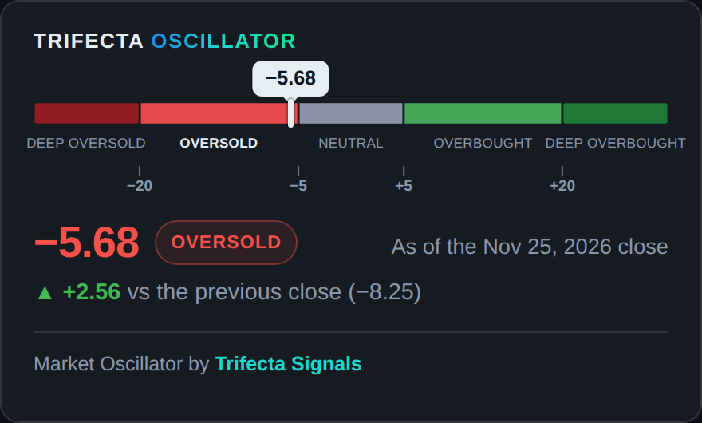

# Trifecta Oscillator — Free JSON Feed

The **Trifecta Oscillator** is a market-breadth oscillator published by
[Trifecta Signals](https://trifectasignals.com). It reads U.S. market
breadth once a day, after the close, and expresses how much stress the
average stock is under as a single number and zone. The oscillator page —
with the chart and its full history — is at
**https://trifectasignals.com/oscillator**.



## What the oscillator is

One number for how much stress the average stock is under. It reads
breadth across the whole market, not just the index, so it reflects the
typical stock rather than the largest ones. Negative readings mean
selling across the average stock has reached oversold territory;
positive readings mean the average stock is stretched the other way,
into overbought territory. Around zero, breadth is in balance.

## How to read it

| Zone | Band |
| --- | --- |
| Extreme Oversold | −10 or lower |
| Oversold | Above −10, through −5 |
| Neutral | Between −5 and +5 |
| Overbought | +5, through below +10 |
| Extreme Overbought | +10 or higher |

The bands meet at their edges: a reading of exactly −5 is Oversold,
exactly −10 is Extreme Oversold, exactly +5 is Overbought, and exactly
+10 is Extreme Overbought.

Trifecta's gauge alerts use a wider rung scale on the same reading —
Deep Oversold at −20 or lower, Oversold at −5, Neutral between −5 and
+5, Overbought at +5, and Deep Overbought at +20 or higher — and fire
only on the close that crosses a rung. The feed's `zone` field uses the
five bands in the table above.

The oscillator is **close-based by design**. It takes one reading per
trading day, from the daily close, and it does not move intraday — the
reading in the morning is the prior close's reading until the next close
is published.

## The record so far

The feed's `series` carries every daily reading back to **October 18,
1999** — 6,819 readings through November 25, 2026. Readings before
October 2018 are reconstructed, and are labeled as reconstructed on the
oscillator page. Across the full span the oscillator has spent 949 days
at Oversold or lower (694 Oversold, 255 Extreme Oversold) and 467 days
at Overbought or higher. Notable extremes from the series:

| When | Reading | What it was |
| --- | --- | --- |
| Oct 10, 2008 | −28.65 | The lowest reading in the series, during the financial crisis. |
| Mar 16, 2020 | −27.86 | The lowest reading of the COVID-19 crash. |
| Apr 14, 2020 | +12.22 | The highest reading in the series, in the rebound off the COVID low. |

## The feed

```
GET https://trifectasignals.com/oscillator.json
```

Plain JSON over HTTPS, no key, no signup. It is updated after each U.S.
market close (the reading is based on the daily close, so it does not
change intraday).

### Fields

| Field | Type | Description |
| --- | --- | --- |
| `gauge` | string | Feed name: `"Trifecta Oscillator"`. |
| `basis` | string | How the reading is computed: `"daily close"`. |
| `value` | number | Current oscillator reading, at two decimals. |
| `zone` | string | Zone for the current reading (see table above). |
| `asOf` | string | Date of the current reading (`YYYY-MM-DD`). |
| `prevValue` | number | Reading at the previous close. |
| `prevDate` | string | Date of the previous close. |
| `prevZone` | string | Zone at the previous close. |
| `change` | number | `value` minus `prevValue`, computed from the underlying full-precision daily prints before rounding — it can differ by 0.01 from the difference of the two rounded values shown. |
| `episodeDay` | number | Day number of the current oversold episode (consecutive closes at −5 or lower). `0` when the current close is not oversold. |
| `firstOversold` | string or null | Date the current oversold episode began (the first close at −5 or lower); `null` when the oscillator is not in an oversold episode. |
| `recent` | array | The most recent 7 readings, each `{date, value, zone}`. |
| `history` | array | The most recent 30 readings, each `{date, value, zone}`. |
| `page` | string | URL of the oscillator page: `"https://trifectasignals.com/oscillator"`. |
| `series` | array | The full history as `[date, value]` pairs, back to October 1999. |

### Sample (live values, trimmed)

```json
{
  "gauge": "Trifecta Oscillator",
  "basis": "daily close",
  "value": -5.68,
  "zone": "Oversold",
  "asOf": "2026-11-25",
  "prevValue": -8.25,
  "prevDate": "2026-11-24",
  "prevZone": "Oversold",
  "change": 2.56,
  "episodeDay": 5,
  "firstOversold": "2026-11-19",
  "recent": [
    { "date": "2026-11-23", "value": -9.95, "zone": "Oversold" },
    { "date": "2026-11-24", "value": -8.25, "zone": "Oversold" },
    { "date": "2026-11-25", "value": -5.68, "zone": "Oversold" }
  ],
  "series": [
    ["1999-10-18", -7.28],
    ["1999-10-19", -7.59],
    "… 6,819 daily points in total …",
    ["2026-11-25", -5.68]
  ]
}
```

## Use it

Ready-to-run examples live in this repository:

- **Python** (standard library only): [`examples/python/oscillator.py`](examples/python/oscillator.py)
- **JavaScript** (Node 18+, built-in `fetch`): [`examples/javascript/oscillator.mjs`](examples/javascript/oscillator.mjs)

Each fetches the feed and prints the current value, zone, and change
versus the previous close.

## Ways people use it

- **Breadth context for research.** Reading the oscillator alongside
  other research shows whether a stock's move is happening while the
  average stock is under stress or in balance.
- **Journaling market stress.** Recording the reading next to a day's
  notes gives a consistent, dated record of breadth conditions — and
  the full series makes it easy to look back at past episodes.
- **Dashboards and scripts.** A single request drops the current
  reading and the full history into a spreadsheet, a dashboard, or a
  chat bot.

## FAQ

- **How often does it update?** Once per trading day, after the U.S.
  market close. It is close-based, so it never changes intraday.
- **How much history is included?** The full daily series from October
  18, 1999 — 6,819 readings as of November 25, 2026 — plus the last 30
  readings in `history`. Readings before October 2018 are
  reconstructed.
- **What does it cost?** Nothing. No key, no signup.
- **Can I display it on my site or in my app?** Yes — see Terms below.
- **Is this financial advice?** No. The oscillator is a breadth measure
  published for information. See Terms.

## Terms

The feed is free to read and display with a visible credit —
"Market Oscillator by Trifecta Signals" — linking back to
https://trifectasignals.com/oscillator. The data is provided as-is,
without warranty, and is not financial advice. The Trifecta Signals
name and logo are not licensed by this repository.

The example code in this repository is licensed under the MIT License —
see [LICENSE](LICENSE). The MIT License covers the code only, not the
feed data.

## More from Trifecta Signals

More free market tools, trackers, and research from Trifecta Signals
are collected on the [Resources page](https://trifectasignals.com/resources).
See also the companion sentiment feed, the
[Trifecta Fear Gauge](https://github.com/trifectasignals/fear-gauge-feed).
